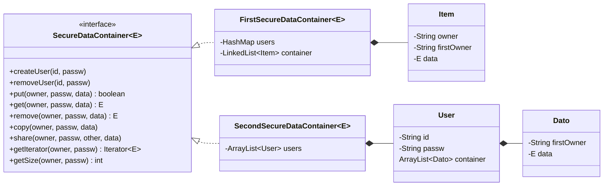

**Author:** Giuseppe Muschetta  
**University:** University of Pisa  
**Degree:** B.Sc. in Computer Science  
**Course:** Programming II (Programmazione II), project part 1: Java

---

<div align="center">

# Secure Data Container

### A Generic, Access-Controlled Data Abstraction in Java, Specified Once and Implemented Twice


**1 interface · 2 implementations · 18 specified operations · 3 checked exceptions of its own · no external libraries**

[Read the report](REPORT.pdf) · [Italian version](primoProgRELAZIONE.pdf) · [Design](#design) · [Get it running](#getting-started)

</div>

---

How do you build a container where many users store their objects, share them with whom they choose and stay in control of what they created, and then show that two very different data structures implement **exactly the same abstraction**?

Secure Data Container answers that question. It is a generic collection, `SecureDataContainer<E>`, that behaves like a small **data storage service**:

- it manages its own **user identities**: every user registers with an ID and a password, and the operations on data authenticate the caller;
- it enforces **access control**: a user sees only their own data and the data other users decided to share with them;
- it tracks the **first owner** of every item, the user who inserted it, so the owner keeps control over every copy they shared.

The type is written **specification first**: the interface documents every operation with its preconditions, side effects, results and exceptions, and two independent classes implement it on top of completely different representations.

## Highlights

| Area | What the container does |
|:---|:---|
| **Specification first** | `SecureDataContainer<E>` documents each of its 18 operations in the style of Liskov and Guttag: `REQUIRES`, `MODIFIES`, `EFFECTS` and `THROWS`, plus an `OVERVIEW` of the abstract type. |
| **Identity management** | User IDs are unique: registering an existing one throws `ExistingUserException`. Data operations check the ID and password pair and throw `UserNotFoundException` when it does not match. |
| **Access control** | `share` grants another registered user access to an item. The recipient can read it, copy it, or drop it for themselves, but never delete it for the owner. |
| **First-owner semantics** | When the first owner removes an item, every copy they shared disappears with it. When a user removes something that was shared with them, only their own access goes. |
| **Cascading deletion** | `removeUser` and `clear` remove a user's data together with every copy they shared with others. |
| **Two representations** | One implementation keeps a single list of all items, each labeled with owner and first owner; the other keeps one list per user. Both document their **abstraction function** and **representation invariant**. |
| **Read-only iteration** | `getIterator` returns an iterator over the caller's items only; `remove()` throws `UnsupportedOperationException`. |
| **Generic and defensive** | Works for any element type `E` through its `equals`. Null arguments throw `NullPointerException` (unchecked); domain errors use checked exceptions. |

## Design



### The ownership model

Every stored item knows who inserted it. That single label, the **first owner**, is what makes the access rules work:

| Operation | Effect |
|:---|:---|
| `put(owner, passw, data)` | Inserts `data`; the caller becomes its first owner. |
| `share(owner, passw, other, data)` | Gives `other` access to a copy of `data`; the first owner does not change. |
| `get(owner, passw, data)` | Returns the item, if the caller has access to it. |
| `copy(owner, passw, data)` | Adds another copy to the caller's items, still labeled with the original first owner. |
| `remove(owner, passw, data)` | First owner: deletes the item and every copy shared with others. Anyone else: removes only their own access. |
| `removeUser(id, passw)` | Deletes the user, their data and every copy of their data held by others. |

### Implementation 1: one list for everything

`FirstSecureDataContainer<E>` maps user IDs to passwords in a `HashMap` and keeps **every item of every user in a single `LinkedList`**. Each element is an `Item` with three fields: the data, its `owner` (who has access to this copy) and its `firstOwner`. Sharing appends a new `Item` with the recipient as owner and the same first owner; a user's view is the set of items whose owner is that user.

### Implementation 2: one list per user

`SecondSecureDataContainer<E>` keeps an `ArrayList` of `User` objects, each with **their own list** of `Dato` elements, a pair of data and first owner. Sharing copies the `Dato` into the recipient's list, and a user's view is simply their list.

### The same state, two representations

After `alice` inserts `report` and shares it with `bob`:

```text
Implementation 1   users     = { alice → ●●●, bob → ●●● }
                   container = [ Item(owner=alice, firstOwner=alice, report),
                                 Item(owner=bob,   firstOwner=alice, report) ]

Implementation 2   users = [ User(alice, ●●●, [ Dato(firstOwner=alice, report) ]),
                             User(bob,   ●●●, [ Dato(firstOwner=alice, report) ]) ]
```

Both map to the same abstract value: each user is associated with the set of items they can access.

## Operations

**Required (9):** `createUser`, `removeUser`, `getSize`, `put`, `get`, `remove`, `copy`, `share`, `getIterator`.

**Optional (9):** `removeAll`, `clear`, `isEmpty`, `isIn`, `printFirstOwnerData`, `printSharedFromOthersData`, `printTotalData`, `printUsersId`, `totalUsers`.

| Exception | Kind | Thrown when |
|:---|:---|:---|
| `ExistingUserException` | checked | a user registers with an ID that is already taken |
| `UserNotFoundException` | checked | the ID and password pair does not match a registered user |
| `DataNotFoundException` | checked | the caller has no access to the requested item |
| `NullPointerException` | unchecked | an argument is `null` |

## Getting started

Any JDK 8 or later. From the repository folder:

```bash
javac -d out *.java
java -cp out com.company.Main
```

`Main` runs a complete scenario on the first implementation: three users register, insert exam records (the immutable `Esame` type used as test data), share them, remove items as first owners and as recipients, copy, clear and finally delete an account, printing every user's view after each step. The same scenario for the second implementation is at the end of `main`, in a commented block: uncomment it to run both and compare their output. The driver's messages are in Italian.

### Using the API

```java
import com.company.*;

public class Example {
    public static void main(String[] args) throws Exception {
        SecureDataContainer<String> box = new FirstSecureDataContainer<>(); // or new SecondSecureDataContainer<>()
        box.createUser("alice", "alice-pw");
        box.createUser("bob", "bob-pw");

        box.put("alice", "alice-pw", "report");
        box.share("alice", "alice-pw", "bob", "report"); // bob can read it, alice stays its first owner
        System.out.println(box.getSize("bob", "bob-pw"));  // 1

        box.remove("alice", "alice-pw", "report");       // the first owner removes it...
        System.out.println(box.getSize("bob", "bob-pw"));  // 0  ...and bob loses it too

        box.put("bob", "wrong-pw", "notes");             // throws UserNotFoundException
    }
}
```

## Repository guide

| File | Content |
|:---|:---|
| [`SecureDataContainer.java`](SecureDataContainer.java) | The interface: overview of the type and the specification of every operation |
| [`FirstSecureDataContainer.java`](FirstSecureDataContainer.java) | Implementation 1: a `HashMap` of users and a single list of `Item` |
| [`SecondSecureDataContainer.java`](SecondSecureDataContainer.java) | Implementation 2: a list of `User`, each with their own list of `Dato` |
| [`ExistingUserException.java`](ExistingUserException.java), [`UserNotFoundException.java`](UserNotFoundException.java), [`DataNotFoundException.java`](DataNotFoundException.java) | The checked exceptions of the type |
| [`Esame.java`](Esame.java) | An immutable exam record, used as test data |
| [`Main.java`](Main.java) | The test scenario for both implementations |
| [`REPORT.pdf`](REPORT.pdf) | The project report, in English: the specification, both representations with their abstraction functions and invariants, and the test results |
| [`primoProgRELAZIONE.pdf`](primoProgRELAZIONE.pdf) | The original project report, in Italian |

## License

Released under the [MIT License](LICENSE).
